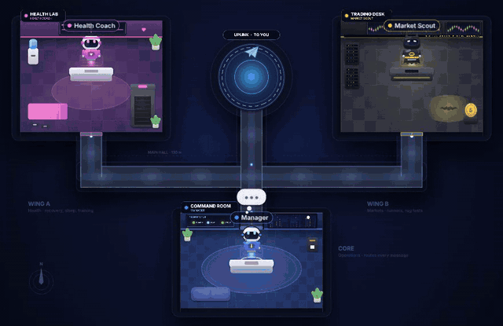
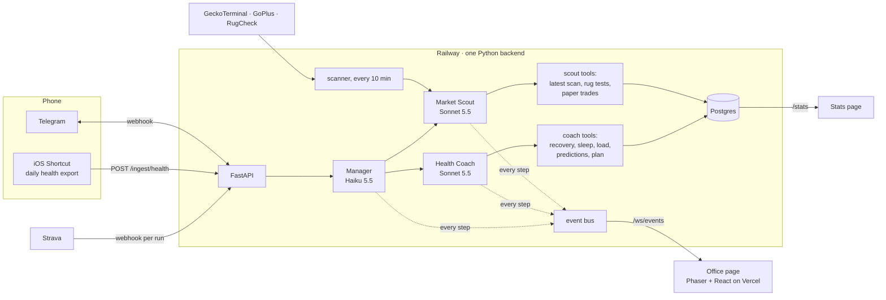
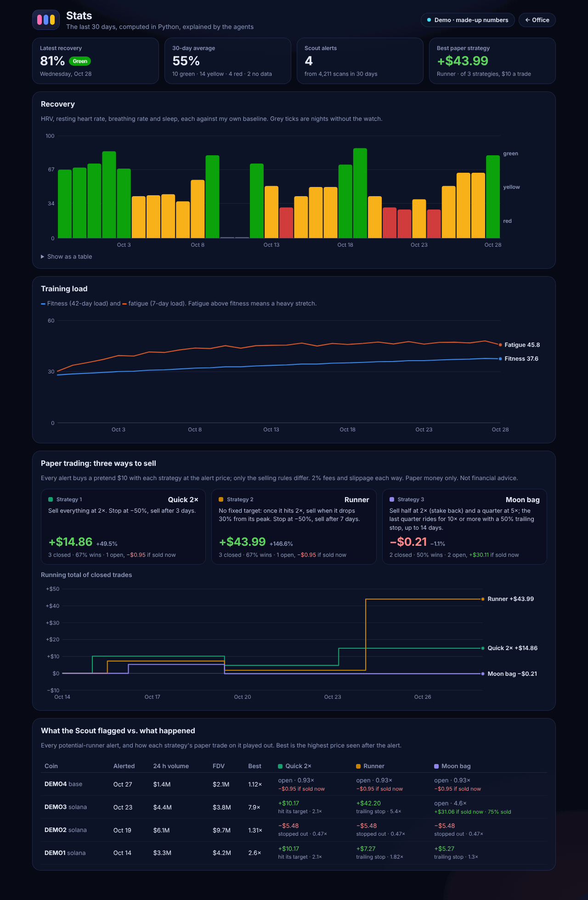

# Agent Office

A cloud-hosted team of three AI agents that I run from Telegram, shown live as robots in a 2D office.

- **Manager** reads my message and hands it to the right specialist.
- **Health Coach** is a Whoop/Garmin-style running coach working from my Apple Watch and Strava data: recovery, strain, sleep, training load, race-time predictions and an adaptive plan.
- **Market Scout** watches brand-new crypto coins and messages me only when one passes rug tests and is doing huge volume. It is read-only and paper-trades every alert to see whether the calls would have made money.



**[Watch the office live](https://agent-office-tau-five.vercel.app/)** (the public version plays a demo with made-up numbers) · **[Stats page](https://agent-office-tau-five.vercel.app/stats)** · Built with Python, FastAPI, Postgres, the Claude API, Telegram, Phaser and React, on Railway and Vercel.

## How it works



**Deterministic math, LLM for language.** Every score, prediction, plan change and rug test is computed in Python and covered by tests (300+ backend tests). The agents call tools that return those numbers, with their breakdowns, and explain them. They never compute or estimate a number themselves.

**Every agent step is an event** (`{agent, status, target, text}`), streamed over a WebSocket. The office plays the events back in order on a single timeline, so the Manager visibly flies all the way to the Health Lab before the Coach answers. The agent loop is a ~100-line tool-use loop over the Anthropic SDK (`backend/app/agents/loop.py`) rather than a framework, so it can emit an event at each step.

## How the readiness (recovery) score works

Recovery is 0–100%: how ready my body is today compared with my own recent normal. Each input becomes a robust z-score against the previous 60 days (median and MAD, so one bad night or sensor glitch doesn't move the baseline), signed so positive is better:

| Input | Compared as | Better when | Weight |
| --- | --- | --- | --- |
| HRV (Apple Watch SDNN) | ln(SDNN) vs. my own baseline | higher | 40% |
| Resting heart rate | bpm vs. baseline | lower | 25% |
| Sleep | hours asleep vs. tonight's need (base + strain + debt) | more | 20% |
| Breathing rate | breaths/min vs. baseline | lower | 10% |
| Wrist temperature | °C vs. baseline | no change | 5% |

Missing inputs are dropped and the remaining weights rescaled; my watch has no temperature sensor, for example. The weighted z goes through the normal CDF, so an ordinary day is 50% and one standard deviation better is 84%. **Green** is ≥ 67%, **yellow** ≥ 34% and **red** below that. HRV is only ever compared with my own baseline, because Apple Watch reports SDNN, which isn't comparable with Whoop's RMSSD.

Alongside it:

- **Strain (0–21)** is Banister TRIMP from Strava heart-rate streams on a saturating curve.
- **Sleep debt** is a fading running balance over 30 nights.
- **Training load** is fitness (42-day load), fatigue (7-day load), form and ACWR.

Race predictions combine VDOT, Riegel and Tanda, and two learned models that are used only where they beat their baselines in cross-validation. A scikit-learn marathon model trained on a public multi-runner dataset beat Riegel and VDOT (MAE 14.4 vs 16.5 min), so it's in; see [its report](backend/app/coach/ml/REPORT.md). A personal pace-vs-heart-rate model didn't beat its baseline on my data yet, so it gives no estimate. The formulas are in `backend/app/metrics/` and `backend/app/coach/`, each documented at the top of its file.

## The Market Scout

Every 10 minutes the scanner screens coins at most 48 hours old on Solana, Base and Ethereum:

- **Market screen:** $1M+ in 24 h volume, 500+ distinct buyers, real liquidity, small average trades (a wash-trading guard), still trading and not dumping.
- **Rug tests:** mint and freeze authority revoked, not a honeypot, low taxes, liquidity locked or burned, and no whale concentration. A test that can't get its data fails.

Only a coin that passes both gets an alert, at most once per coin and three a day. Each alert opens a pretend $10 paper trade, sold at 2×, at −50%, if liquidity vanishes, or after 3 days, with 2% fees each way. The stats page shows every alert next to what happened. It has no wallet, no keys and no trading. Details: [docs/scout.md](docs/scout.md).

## Stats



## Costs

| Item | Per month | Notes |
| --- | --- | --- |
| Railway (backend + Postgres) | $0 | Free trial; it has run everything so far |
| Claude API | ~$3–8 | Haiku 5.5 routes ($0.10 / $0.50 per million input/output tokens); Sonnet 5.5 coaches and scouts ($2 / $10). A question costs roughly 2–5¢, mostly the Sonnet tool calls; the market scan itself uses no model at all |
| Vercel (office page) | $0 | Free tier |
| Telegram, Strava, iOS Shortcuts, GeckoTerminal, GoPlus, RugCheck | $0 | Free APIs |

These are estimates from my own usage (a morning summary plus a handful of questions a day). Check current pricing before relying on them.

## Repo map

```
backend/app/
  agents/     agent loop, Manager / Coach / Scout and their tools, event bus, WebSocket
  metrics/    recovery, strain, sleep (pure functions, tested)
  coach/      training load, VDOT, zones, race predictor, plan, warnings, ML model
  scout/      market screen, rug tests, scanner, paper trading
  ingest/     iOS Shortcut payloads, Apple Health export, Strava webhooks and backfill
  telegram/   bot webhook and the morning summary
frontend/src/
  office/     the office: floor plan and routes, timeline, robots, rooms, overlay
  stats/      the stats page
docs/         setup guides (Railway, Telegram, Strava, the health Shortcut), office, scout
```

[PLAN.md](PLAN.md) has the build plan, phase by phase, and a **challenges log** of real problems hit along the way and how they were fixed. [CLAUDE.md](CLAUDE.md) has the stack and repo rules.

## Running it locally

```bash
cp .env.example .env            # fill in real values; .env is gitignored

# Backend (Python 3.12)
cd backend
python3.12 -m venv .venv && source .venv/bin/activate
pip install -e ".[dev]"
uvicorn app.main:app --reload   # http://localhost:8000/health
ruff check . && ruff format --check . && pytest

# Frontend (Node 22)
cd frontend
npm install
npm run dev                     # http://localhost:5173 (demo), /stats for the stats page
npm test && npm run lint && npm run build
```

Not financial advice. The health scores are approximations of the commercial ones, not medical advice.
