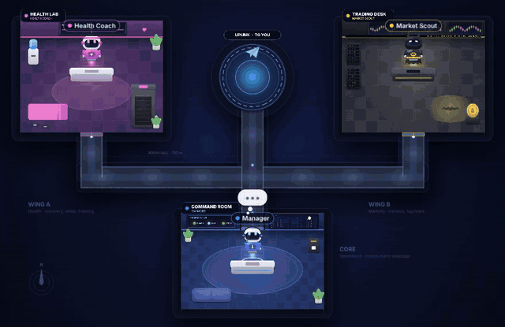
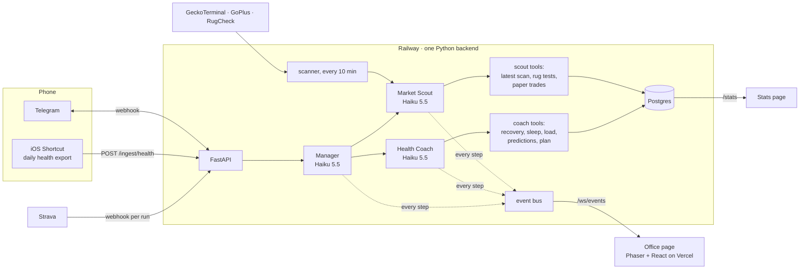
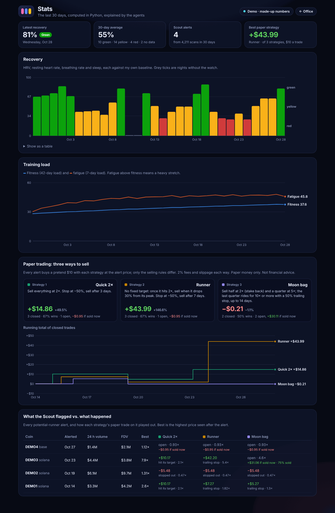
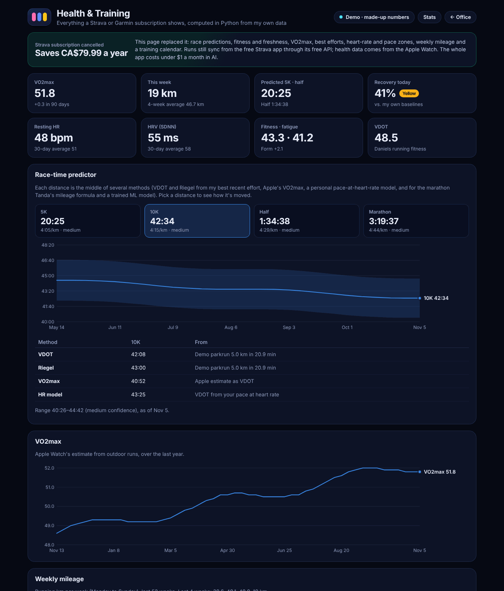

# Agent Office

A cloud-hosted team of three AI agents that I run from Telegram, shown live as robots in a 2D office.

- **Manager** reads my message and hands it to the right specialist.
- **Health Coach** is a Whoop/Garmin-style running coach working from my Apple Watch and Strava data: recovery, strain, sleep, training load, race-time predictions and an adaptive plan.
- **Market Scout** watches brand-new crypto coins and messages me only when one passes rug tests and is doing huge volume. It is read-only.
- **Paper Trader** (a robot, not a model) paper-trades every alert three ways, so the stats page shows which way of selling would have made money.



**[Watch the office live](https://agent-office-tau-five.vercel.app/)** (the public version plays a demo with made-up numbers) · **[Stats page](https://agent-office-tau-five.vercel.app/stats)** · **[Health & Training page](https://agent-office-tau-five.vercel.app/health)** · Built with Python, FastAPI, Postgres, the Claude API, Telegram, Phaser and React, on Railway and Vercel.

## How it works



**Deterministic math, LLM for language.** Every score, prediction, plan change and rug test is computed in Python and covered by tests (300+ backend tests). The agents call tools that return those numbers, with their breakdowns, and explain them. They never compute or estimate a number themselves.

**Every agent step is an event** (`{agent, status, target, text}`), streamed over a WebSocket. The office plays the events back in order on a single timeline, so the Manager visibly flies all the way to the Health Lab before the Coach answers. The agent loop is a ~100-line tool-use loop over the Anthropic SDK (`backend/app/agents/loop.py`) rather than a framework, so it can emit an event at each step.

## How the readiness (recovery) score works

Recovery is 0–100%: how ready my body is today compared with my own recent normal. Each input becomes a robust z-score against the previous 60 days (median and MAD, so one bad night or sensor glitch doesn't move the baseline), signed so positive is better:

| Input | Compared as | Better when | Weight |
| --- | --- | --- | --- |
| HRV (Apple Watch SDNN) | ln(SDNN) vs. my own baseline | higher | 40% |
| Resting heart rate | bpm vs. baseline | lower | 25% |
| Sleep | hours asleep vs. tonight's need (base + strain + debt) | more | 20% |
| Breathing rate | breaths/min vs. baseline | lower | 10% |
| Wrist temperature | °C vs. baseline | no change | 5% |

Missing inputs are dropped and the remaining weights rescaled; my watch has no temperature sensor, for example. The weighted z goes through the normal CDF, so an ordinary day is 50% and one standard deviation better is 84%. **Green** is ≥ 67%, **yellow** ≥ 34% and **red** below that. HRV is only ever compared with my own baseline, because Apple Watch reports SDNN, which isn't comparable with Whoop's RMSSD.

Alongside it:

- **Strain (0–21)** is Banister TRIMP from Strava heart-rate streams on a saturating curve.
- **Sleep debt** is a fading running balance over 30 nights.
- **Training load** is fitness (42-day load), fatigue (7-day load), form and ACWR.

Race predictions combine VDOT, Riegel and Tanda, and two learned models that are used only where they beat their baselines in cross-validation. A scikit-learn marathon model trained on a public multi-runner dataset beat Riegel and VDOT (MAE 14.4 vs 16.5 min), so it's in; see [its report](backend/app/coach/ml/REPORT.md). A personal pace-vs-heart-rate model didn't beat its baseline on my data yet, so it gives no estimate. The formulas are in `backend/app/metrics/` and `backend/app/coach/`, each documented at the top of its file.

## The Market Scout

Every 10 minutes the scanner screens coins at most 48 hours old on Solana, Base and Ethereum:

- **Market screen:** $1M+ in 24 h volume, 500+ distinct buyers, real liquidity, small average trades (a wash-trading guard), still trading and not dumping.
- **Rug tests:** mint and freeze authority revoked, not a honeypot, low taxes, liquidity locked or burned, and no whale concentration. A test that can't get its data fails.

Only a coin that passes both gets an alert, at most once per coin and three a day. It has no wallet, no keys and no trading. Details: [docs/scout.md](docs/scout.md).

**Paper trading, three ways.** Each alert buys a pretend $10 with each of three strategies, which only differ in how they sell, with 2% fees each way:

| # | Strategy | Sells |
| --- | --- | --- |
| 1 | Quick 2× | everything at 2×; stop at −50%; after 3 days |
| 2 | Runner | once it's hit 2×, everything when it drops 30% from its peak; stop at −50%; after 7 days |
| 3 | Moon bag | half at 2× (stake back), a quarter at 5×, the last quarter rides for 10×+ with a 50% trailing stop; up to 14 days |

New-coin returns are extremely skewed (most fall 90%+ from their peak, a few run far past 2×), so selling everything at 2× caps the winners that pay for the losers. The stats page tracks all three side by side on the same alerts.

## Evals

About 50 questions the owner might text, run through the real agents against a made-up but realistic world, and graded automatically: did the Manager ask the right specialist, did it call the right tools, is every number in the answer backed by a tool result, and does every crypto answer end with the disclaimer. The same questions run with Sonnet answering (production) and with Haiku everywhere, with cost per answer and response times, so the model choice is measured rather than guessed. How it works and how to run it: [docs/evals.md](docs/evals.md).

Latest run (2026-11-03, 54 questions each):

| Setup | Passed | Right specialist | Right tools | Numbers backed by tools | Disclaimer | Guard rewrites | Cost per answer | Median time |
| --- | --- | --- | --- | --- | --- | --- | --- | --- |
| All Haiku 5.5 (now in production) | 54/54 | 100% | 100% | 100% | 100% | 0 | 0.11¢ | 6.3 s |
| Haiku 5.5 routes, Sonnet 5.5 answers (the setup before) | 54/54 | 100% | 100% | 100% | 100% | 2 | 1.55¢ | 7.3 s |

How it got there, run by run:

| Run | Production | All Haiku | What changed |
| --- | --- | --- | --- |
| 1 | 36/52 | 40/52 | First run |
| 2 | 48/52 | 51/52 | Fixed the grader: numbers from tool field names and descriptions, date ranges |
| 3 | 54/54 | 54/54 | Number guard in the live agents; "show me my last 7 days" routed to the Coach only; 2 new cases |

The guard is the same number check, run live: an answer with a number no tool backs up goes back for one rewrite, and in run 3 it caught and fixed two such answers before they'd have been sent. All-Haiku matched Sonnet on every run at a fourteenth of the cost, so production now runs Haiku 5.5 for all three agents; the evals keep the Sonnet setup (`sonnet-specialists`) to compare against before any change back.

## Stats



The stats page also has a card per paper strategy (its rules, closed P/L, win rate, and what the open trades would make if sold now), a running-total chart of the three, and each alert's result under each strategy.

## Health & Training page



`/health` shows everything a Strava or Garmin subscription did, computed in Python from my own Apple Watch and Strava data, so I cancelled my Strava subscription (about CA$80 a year). Runs still sync from the free Strava app through its free API.

- **Race-time predictor:** 5K, 10K, half and marathon, each with its pace, range, confidence, the methods behind it, and how it has moved over six months.
- **VO2max** over the last year (Apple Watch's estimate).
- **Fitness age:** the age at which a typical person has my VO2max (like Garmin's Fitness Age or WHOOP Age), from the FRIEND registry's median VO2max per decade, next to my real age (`ATHLETE_BIRTH_MONTH`) and charted over the year.
- **Running score (VDOT):** Daniels' fitness number now (efforts from the last 8 weeks) and my best ever (from all-time best efforts).
- **Mileage:** weekly km for 52 weeks, totals (last 4 weeks, year to date, all time), and a 12-week training calendar.
- **Fitness & freshness:** fitness, fatigue and form from heart rate on every run.
- **Zones and records:** time in each heart-rate zone over the last 4 weeks, Daniels pace zones, and personal records from Strava's best efforts.
- **Daily numbers:** recent runs (pace, heart rate, climb, cadence), resting heart rate and HRV over 90 days, sleep stages for 30 nights, running form (cadence, ground contact, vertical oscillation, stride length), and this week's training plan.

Like the stats page it needs the office key (`GET /stats/health`); without it, it shows made-up demo numbers.

## Costs

| Item | Per month | Notes |
| --- | --- | --- |
| Railway (backend + Postgres) | $0 | Free trial; it has run everything so far |
| Claude API | under $1 | Haiku 5.5 for all three agents ($0.10 / $0.50 per million input/output tokens). A question costs about 0.1¢ (measured by the evals; it was 1.5¢ with Sonnet 5.5 answering). The market scan itself uses no model at all |
| Vercel (office page) | $0 | Free tier |
| Telegram, Strava, iOS Shortcuts, GeckoTerminal, GoPlus, RugCheck | $0 | Free APIs |

These are estimates from my own usage (a morning summary plus a handful of questions a day). Check current pricing before relying on them. On the other side of the ledger, the Health & Training page let me cancel my Strava subscription, which saves about CA$80 a year.

## Repo map

```
backend/app/
  agents/     agent loop, Manager / Coach / Scout and their tools, event bus, WebSocket
  metrics/    recovery, strain, sleep (pure functions, tested)
  coach/      training load, VDOT, zones, race predictor, plan, warnings, ML model
  scout/      market screen, rug tests, scanner, paper trading
  ingest/     iOS Shortcut payloads, Apple Health export, Strava webhooks and backfill
  telegram/   bot webhook and the morning summary
frontend/src/
  office/     the office: floor plan and routes, timeline, robots, rooms, overlay
  stats/      the stats page
docs/         setup guides (Railway, Telegram, Strava, the health Shortcut), office, scout
```

[PLAN.md](PLAN.md) has the build plan, phase by phase, and a **challenges log** of real problems hit along the way and how they were fixed. [CLAUDE.md](CLAUDE.md) has the stack and repo rules.

## Running it locally

```bash
cp .env.example .env            # fill in real values; .env is gitignored

# Backend (Python 3.12)
cd backend
python3.12 -m venv .venv && source .venv/bin/activate
pip install -e ".[dev]"
uvicorn app.main:app --reload   # http://localhost:8000/health
ruff check . && ruff format --check . && pytest

# Frontend (Node 22)
cd frontend
npm install
npm run dev                     # http://localhost:5173 (demo), /stats for the stats page
npm test && npm run lint && npm run build
```

Not financial advice. The health scores are approximations of the commercial ones, not medical advice.
